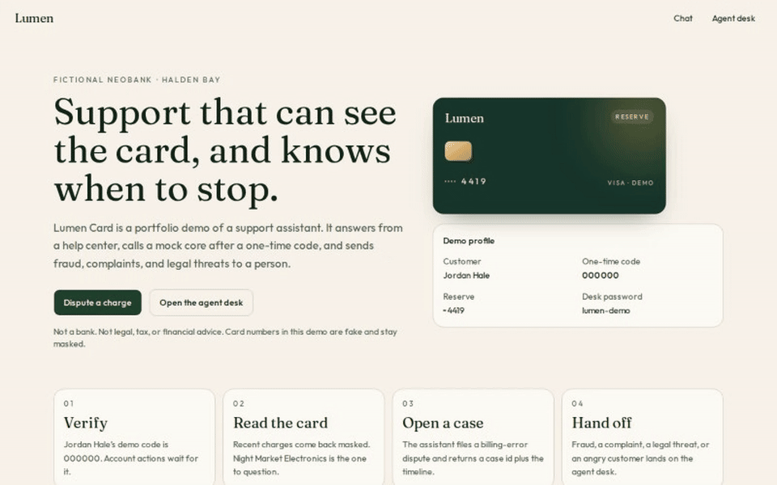
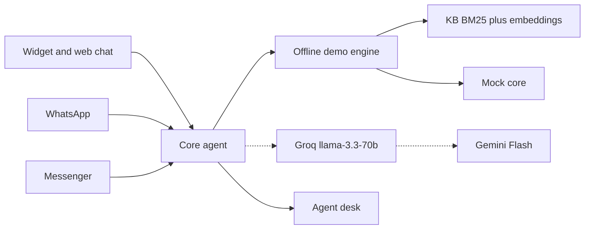
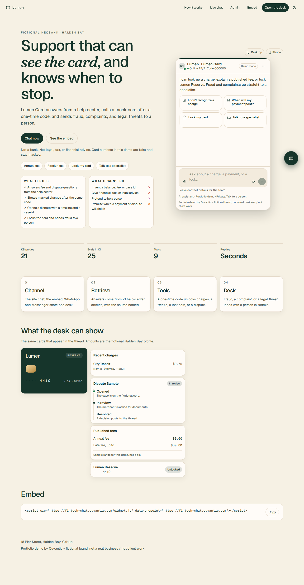
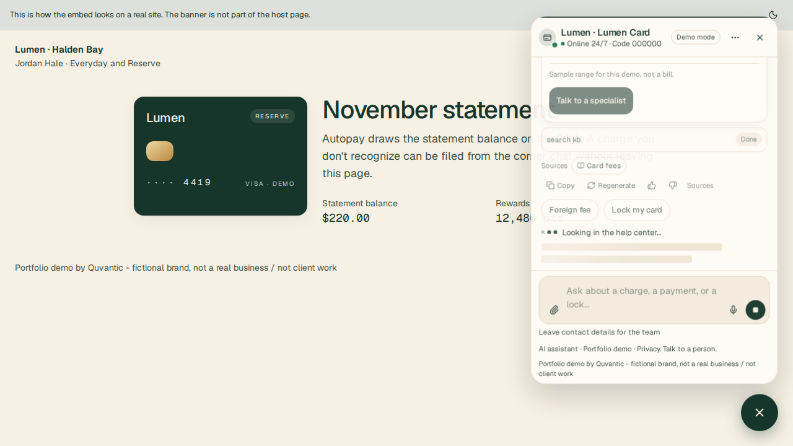
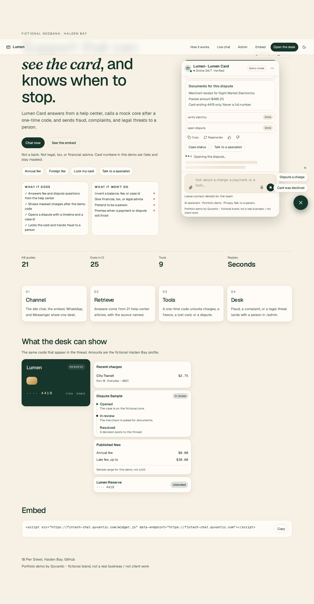

# Lumen Card support

Portfolio demo by Quvantic - fictional brand, not a real business / not client work.



A support assistant for **Lumen Card**, a fictional neobank in Halden Bay. The widget uses a branded launcher and teaser, dispute timelines, fee cards, callback slots, and a desk that can hand the chat back to the assistant. It answers from a help center, calls a mock core after a one-time code, and hands fraud, complaints, legal threats, and questions it cannot ground to a person.

Live demo: https://fintech-chat.quvantic.com

## Run it

```bash
pnpm install
pnpm dev
```

Open http://localhost:38471. The agent desk is http://localhost:38471/admin. The widget sample is http://localhost:38471/embed-demo.

`pnpm build` and `npm run build` need no environment variables. With no API keys the app uses the offline demo engine.

| | |
| --- | --- |
| Customer | Jordan Hale |
| One-time code | `000000` |
| Reserve card | ···· 4419 |
| Everyday card | ···· 8821 |
| Desk password | `lumen-demo` |
| Webhook verify token | `lumen-verify` |

## Features

- Landing page with the demo path and an under-the-hood map.
- Website chat and an embeddable widget (`/widget.js`) with quick replies, streaming, a typing indicator, markdown, and source citations.
- RAG over 21 markdown articles in `/kb` (chunking, BM25, and a local hashed embedding). Low confidence hands off. Off-topic questions are refused.
- Zod-shaped tools against a seeded mock core: verify, transactions, freeze, unfreeze, lost card, dispute, dispute status, escalate. State resets from the chat.
- Agent desk with conversations, tool calls, dispute tickets, and handoffs. A specialist reply shows up in the customer chat.
- WhatsApp and Messenger webhooks on the same agent. See `docs/channels.md`.
- Guardrails: card numbers are masked in replies and logs, prompt injection does not skip the identity check, and the assistant does not give financial advice.

## Architecture



Groq runs only when `GROQ_API_KEY` is set. If Groq fails or is unset and `GEMINI_API_KEY` is set, Gemini 2.5 Flash is next, then Gemini 2.0 Flash. Otherwise the deterministic engine answers. CI uses that engine and has no secrets.

## Embed

```html
<script src="https://fintech-chat.quvantic.com/widget.js" data-endpoint="https://fintech-chat.quvantic.com"></script>
```

## Eval results

Offline demo engine, 25 of 25 cases in `evals/cases.json`. Regenerate with `pnpm eval`. Full table: `evals/out/scorecard.md`. JSON: `evals/out/scorecard.json`.

| Case | Result |
| --- | --- |
| foreign_fee | pass |
| annual_fee | pass |
| reg_z | pass |
| reg_e | pass |
| freeze_help | pass |
| atm_limit | pass |
| rewards | pass |
| autopay | pass |
| kyc | pass |
| closure | pass |
| phishing | pass |
| replacement_help | pass |
| dispute_flow | pass |
| transactions_step_up | pass |
| wrong_otp | pass |
| freeze_step_up | pass |
| lost_card | pass |
| injection_pan | pass |
| injection_skip | pass |
| advice | pass |
| handoff_legal | pass |
| handoff_human | pass |
| off_topic | pass |
| low_confidence | pass |
| autopay_not_a_dispute | pass |

## Tests

```bash
pnpm lint
pnpm typecheck
pnpm test:unit
pnpm eval
pnpm build
pnpm test:e2e
```

Screenshots from the browser tests are in `docs/screenshots/`.





## Deploy

See `DEPLOY.md`. Target host: `https://fintech-chat.quvantic.com`. `vercel.json` is included. Set `GROQ_API_KEY` and `GEMINI_API_KEY` only if you want a live model. The demo works with neither.

Portfolio demo by Quvantic - fictional brand, not a real business / not client work.
